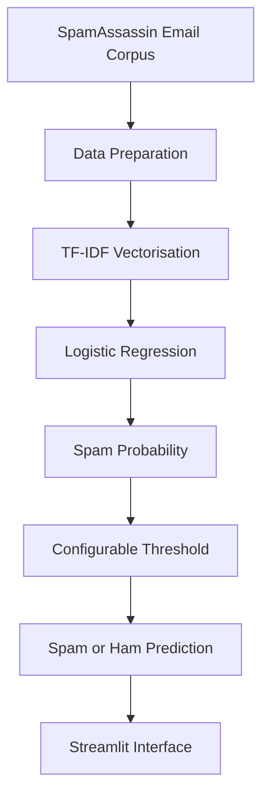
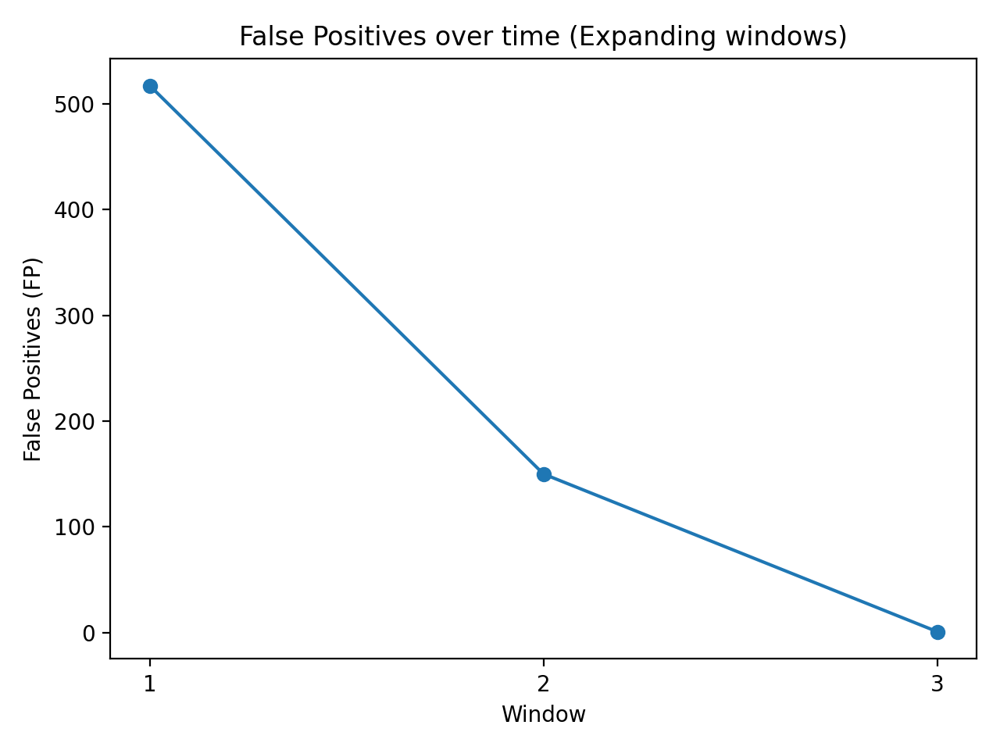
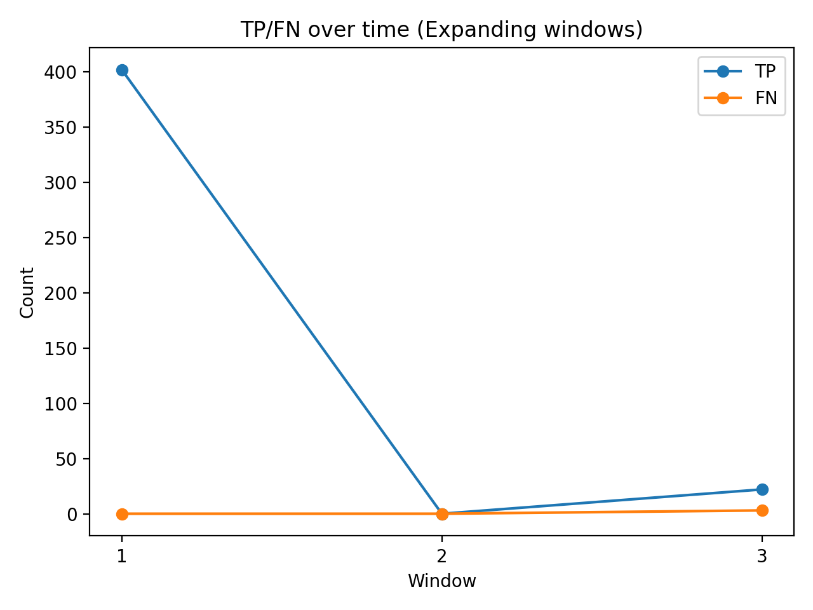

# Email Spam Detection

### NLP Classification, Probability Thresholding & Temporal Evaluation


Email Spam Detection is an end-to-end Machine Learning project that classifies emails as spam or legitimate messages using the Apache SpamAssassin public corpus.

The project implements a **TF-IDF + Logistic Regression** classification pipeline with a Streamlit interface for interactive predictions.

Beyond the baseline model, it explores chronological evaluation to understand how spam detection performance changes across different time periods.

> **Project Focus:** Natural Language Processing · Machine Learning · Classification · Model Evaluation

---

## Overview

Email spam detection is a binary text classification problem.

The model attempts to distinguish between:

- **Spam:** Unsolicited or unwanted email
- **Ham:** Legitimate email

A practical challenge is that spam patterns change over time.

A classifier performing well on one collection of emails may produce significantly different results when evaluated on messages from another period.

This project investigates that challenge through baseline classification and expanding-window temporal evaluation.

---

## Machine Learning Pipeline



The system separates text representation, model prediction, and decision thresholding.

This allows the classification threshold to be adjusted without changing the underlying trained model.

---

## Core Features

### 1. Email Text Classification

The application classifies email text into:

- Spam
- Ham

The baseline uses TF-IDF features with Logistic Regression.

### 2. Configurable Decision Threshold

The classification threshold is stored in:

```text
models/threshold.txt
```

This allows the application's decision boundary to be adjusted.

### 3. Interactive Streamlit Application

The web interface supports:

- Email text input
- Spam/ham prediction
- Model probability display
- Threshold-based classification

The displayed model probability is not automatically a calibrated measure of real-world confidence.

### 4. Reproducible Model Workflow

The repository includes:

- Data loading
- Model training
- Evaluation
- Saved model artifacts
- Threshold configuration

### 5. Time-Based Evaluation

A research extension uses expanding chronological windows to examine model performance on later email observations.

This helps identify changes in classification behaviour across time periods.

---

## Dataset

The project uses the Apache SpamAssassin public mail corpus.

**Official Source:** [Apache SpamAssassin Public Corpus](https://spamassassin.apache.org/old/publiccorpus/)

The selected archives are:

- `20030228_spam_2.tar.bz2`
- `20030228_easy_ham.tar.bz2`

The corpus provides examples of spam and legitimate emails for developing and evaluating text classifiers.

Raw dataset files are excluded from Git tracking.

---

## Model Development

### TF-IDF

Term Frequency–Inverse Document Frequency transforms text into numerical features based on term frequency and relative importance.

TF-IDF provides a straightforward representation for traditional machine learning models.

### Logistic Regression

Logistic Regression is used as the baseline classifier.

The model estimates the probability associated with the spam class.

A configurable decision threshold converts that probability into a spam or ham label.

### Why This Baseline?

TF-IDF with Logistic Regression provides:

- A relatively simple training workflow
- Fast inference
- Interpretable baseline behaviour
- A useful starting point for evaluating text classification

It offers a foundation for studying how preprocessing, thresholds, and data distribution affect classification performance.

---

## Decision Threshold

The application reads the classification threshold from:

```text
models/threshold.txt
```

For example:

```text
0.60
```

To update the threshold:

```bash
echo 0.60 > models/threshold.txt
```

### Threshold Tradeoffs

A lower threshold generally identifies more messages as spam but may increase false positives.

A higher threshold generally reduces spam classifications but may allow more spam through.

The appropriate threshold depends on the cost of different classification errors.

**False positives are especially important in spam filtering because legitimate messages can be incorrectly classified as spam.**

The chronological evaluation results below use a threshold of `0.5`, which may differ from the current Streamlit threshold configuration.

---

## Time-Based Evaluation

### Research Objective

A random train/test split may not adequately represent how a spam filter behaves when applied to emails arriving later.

The project therefore includes an expanding-window evaluation approach inspired by chronological spam-filter testing.

The model is evaluated across successive time periods to observe changes in classification performance.

Time-based evaluation reduces some forms of unrealistic mixing between earlier and later observations, although it does not eliminate all possible sources of leakage or bias.

---

## Expanding-Window Results

Three chronological evaluation windows were tested using:

```text
Classification threshold = 0.5
```

### Confusion Matrix Results

| Window | Test Period (UTC) | TN | FP | FN | TP |
| :--- | :--- | ---: | ---: | ---: | ---: |
| 1 | 2002-07-23 → 2002-09-04 | 42 | 517 | 0 | 402 |
| 2 | 2002-09-04 → 2002-09-26 | 811 | 150 | 0 | 0 |
| 3 | 2002-09-26 → 2003-07-20 | 934 | 1 | 3 | 22 |

Where:

- **TN:** Legitimate emails correctly classified
- **FP:** Legitimate emails incorrectly classified as spam
- **FN:** Spam emails incorrectly classified as legitimate
- **TP:** Spam emails correctly classified

### Window 1

The model identified the spam examples in the reported test window but produced 517 false positives.

This indicates a serious problem with legitimate emails being classified as spam during that period.

### Window 2

The test partition contained no spam examples.

As a result, spam precision, recall, and F1 are not meaningful indicators for this window.

The false-positive count of 150 remains useful for examining how legitimate messages were classified.

### Window 3

The reported results were substantially stronger:

- 934 true negatives
- 1 false positive
- 3 false negatives
- 22 true positives

However, strong results in one time window do not guarantee similar performance in other periods.

### Key Finding

**Classification performance changed considerably across chronological windows.**

The experiment demonstrates why evaluating a spam classifier across time can reveal weaknesses that may not be obvious from a single aggregate score.

---

## Temporal Evaluation Visualisations

### False Positives Over Time



### True Positives vs False Negatives



These visualisations help compare error behaviour across the evaluated periods.

---

## Technology Stack

| Technology | Purpose |
| :--- | :--- |
| Python | Core ML development |
| Scikit-learn | TF-IDF and Logistic Regression |
| Jupyter Notebook | Training and baseline evaluation |
| Streamlit | Interactive application |
| GitHub Actions | Basic continuous integration |
| Git | Version control |

The specific project dependencies are declared in:

```text
requirements.txt
```

---

## Getting Started

### Prerequisites

- Python
- pip
- Internet connection for initial dataset download

### 1. Clone the Repository

```bash
git clone https://github.com/GaneshPokharel-tech/email-spam-detection.git
cd email-spam-detection
```

### 2. Create a Virtual Environment

```bash
python3 -m venv .venv
```

Activate it on macOS or Linux:

```bash
source .venv/bin/activate
```

### 3. Install Dependencies

```bash
pip install -r requirements.txt
```

---

## Download the Dataset

Create the raw data directory:

```bash
mkdir -p data/raw
cd data/raw
```

Download the SpamAssassin archives:

```bash
curl -L -o spam_2.tar.bz2 https://spamassassin.apache.org/old/publiccorpus/20030228_spam_2.tar.bz2

curl -L -o easy_ham.tar.bz2 https://spamassassin.apache.org/old/publiccorpus/20030228_easy_ham.tar.bz2
```

Extract the archives:

```bash
tar -xjf spam_2.tar.bz2
tar -xjf easy_ham.tar.bz2
```

Return to the repository root:

```bash
cd ../..
```

Expected directories:

```text
data/raw/spam_2/
data/raw/easy_ham/
```

---

## Train and Evaluate the Model

Start Jupyter Notebook:

```bash
jupyter notebook
```

Open:

```text
notebooks/01_data_load_and_split.ipynb
```

Run the notebook cells in order to perform the documented baseline training and evaluation workflow.

The Streamlit application requires the trained model artifacts to be available in the expected `models/` location.

---

## Run the Streamlit Application

From the repository root:

```bash
streamlit run streamlit_app/app.py
```

Streamlit will display a local application URL, usually:

```text
http://localhost:8501
```

Enter email text to obtain the model's spam/ham prediction and probability output.

---

## Run Time-Based Evaluation

The chronological evaluation is implemented in:

```text
src/time_eval.py
```

Run:

```bash
python src/time_eval.py
```

This executes the documented expanding-window evaluation workflow.

---

## Continuous Integration

GitHub Actions runs basic project checks on push and pull-request events.

The documented CI workflow covers:

- Dependency installation
- Import checks
- Python syntax checks

These checks help catch basic environment and code problems.

They are not a substitute for comprehensive model regression tests or evaluation on new data.

---

## Project Structure

```text
email-spam-detection/
│
├── notebooks/
│   └── 01_data_load_and_split.ipynb
│
├── data/
│   └── raw/
│
├── models/
│   ├── Saved ML pipeline
│   └── threshold.txt
│
├── src/
│   └── time_eval.py
│
├── streamlit_app/
│   └── app.py
│
├── assets/
│   ├── fp_over_time.png
│   └── tp_fn_over_time.png
│
├── .github/workflows/
│   └── ci.yml
│
├── requirements.txt
└── README.md
```

---

## Limitations

- The project uses an older public email corpus.
- Historical spam patterns may differ from modern email threats.
- Results vary substantially across the documented chronological windows.
- The first two windows produced substantial false-positive counts.
- One evaluation window contained no positive spam examples.
- Model probability estimates are not guaranteed to be calibrated.
- Changing the classification threshold affects false positives and false negatives.
- Temporal evaluation does not eliminate all forms of data leakage.
- The application is a learning and research demonstration, not a production email security service.

---

## Future Improvements

Potential areas for further development:

- More recent email datasets
- Improved false-positive reduction
- Probability calibration
- Additional NLP model baselines
- Expanded chronological evaluation
- Data drift monitoring
- Automated model regression tests
- Threshold optimisation on separate validation data
- Evaluation against unseen email sources

These are possible improvements, not features claimed to be implemented.

---

## Author

**Ganesh Pokharel**

AI Engineer | Python Developer

[GitHub](https://github.com/GaneshPokharel-tech) · [LinkedIn](https://www.linkedin.com/in/ganesh-pokharel-30786b192/)

---

*An applied NLP and Machine Learning project exploring email classification, decision thresholds, and temporal model reliability.*
